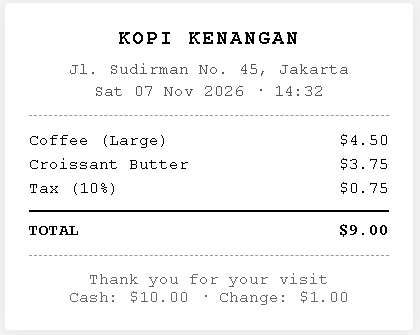

<!--
┌────────────────────────────────────────────────────────────────────┐
│  ⌂  SATURUMAH.NET · FINANCIAL OS · FILE CONTRACT
├────────────────────────────────────────────────────────────────────┤
│  File      : README.md
│  Purpose   : GitHub front door — for judges, users, and future devs
│  Author    : Jack — Jack[at]SatuRumah[dot]Net
│  GitHub    : https://github.com/setuju
│  Website   : https://saturumah.net
│  Created   : 10-11-2026
│  License   : MIT
└────────────────────────────────────────────────────────────────────┘
-->

# Financial OS

**Natural-language personal finance with ethical surplus distribution.**

Type, speak, or photograph money transactions. Track only surplus after obligations, plan long-term goals on a Gantt timeline, and route 10% of verified surplus to vetted causes via **PayPal Payouts**. Principal savings are never touched. Every payout requires two-step confirmation.

> **Sandbox only. No real money moves.**

[](https://financial.saturumah.net)
[](https://financial-api.saturumah.net/health)
[](LICENSE)
[](https://paypalaihackathon.devpost.com/)

---

## Try it now

| Access | Credentials | What you see |
|---|---|---|
| **Admin** | name `admin` · password `financial-os` | Seeded demo data (Jul–Nov 2026): 100+ transactions, 3 goals, 2 oracles, 5 surplus periods |
| **New session** | [financial.saturumah.net/signup](https://financial.saturumah.net/signup) — pick a name, get a 5-char password | Empty slate. Isolated per session. |

**Live frontend:** https://financial.saturumah.net · **API:** https://financial-api.saturumah.net/health

> **First request after 15 min idle** may take ~50s (Render free tier). Subsequent: 100–300ms.

---

## Demo Showcase: AI Receipt Scanning

<p align="center">
  
</p>

**AI vision** (Groq Qwen 3.8 27B + OCR.space fallback) extracts merchant and total. The rule-based parser auto-structures it into a transaction.

> **Disclaimer:** The receipt is a synthetic mock. Store name, items, and prices are fictional. Any resemblance to actual receipts or transactions is coincidental.

---

## Hackathon 2026

Built for [PayPal AI Hackathon 2026](https://paypalaihackathon.devpost.com/) between **Oct 1 – Nov 12, 2026**, solo, targeting:

- 🎯 **Most Impactful** — ethical surplus, principal untouched, human-in-the-loop
- 🎯 **Most Creative** — parser rejects plans & cancellations; multi-transaction parsing; Surplus Oracle
- 🎯 **Best Demo Delivery** — end-to-end flow within 3 minutes
- 🎯 **Best Use of Bryntum** — Gantt timeline gates PayPal payouts
- 🎯 **Best Use of APIMatic** — generated TypeScript SDK from PayPal OpenAPI
- 🎯 **Best Use of PayPal + AI** — 4 AI modalities feeding a live payout pipeline

**AI tools used** (per submission rules):
- **Gemini 3.8 Flash** via OpenRouter → scoped assistant (primary)
- **Gemini 3 Flash Preview** via Google AI Studio → assistant fallback (proven live during submission week)
- **Qwen 3.8 27B** via Groq → OCR vision extraction (primary)
- **OCR.space** → OCR fallback (traditional, no LLM)

---

## Why this exists

Most finance apps treat every leftover dollar as "disposable". Financial OS introduces **Ethical Surplus** — surplus calculated *after* obligations, never touching principal. Every allocation requires explicit two-step confirmation.

**No auto-donate. No guilt trip. No touching your rent money.**

---

## Core concepts

**Anti-Budget Parser** — Natural-language input in English or Bahasa Indonesia. Rejects plans (`"i want to buy a bike for 500 dollars"` → `planned_input`), cancellations (`"never mind the coffee"` → `negated_input`), and negations. Supports **multiple transactions** in one sentence: `"i get 5000 from freelance and 2000 from bonus then pay rent 1500"` → 3 separate transactions. Uses **First-Verb-Wins** logic for context: `"i get pay 500"` = income; `"i pay rent 500"` = expense.

**Ethical Surplus** — Only surplus after obligations can be distributed:

```
closing = opening + income − expense − horizon_bills − donations
```

Each month's closing becomes the next month's opening. `horizon_bills` = committed obligations from active Horizon goals.

**Surplus Oracle** — Predict next week's/month's surplus. Mark achieved when hit — celebration modal.

**Financial Horizon** — Long-term goals on **Bryntum Gantt 8**. Each active goal contributes `monthly_saving` to `horizon_bills`, subtracted from each month's distributable surplus. **The Gantt gates the payout.** Product search powered by **Channel3** API — pick a real product, price auto-fills the goal.

**Impact Wallet** — Verified surplus (last closed month) plus in-progress (current month) plus 6-month history. 8 vetted causes (Red Cross, Direct Relief, UNICEF, WCK, Water.org, MSF, Rainforest Alliance, Save the Children). Two-step confirm. Log preserves audit trail after soft-delete. Live disaster/news feed from USGS + Google News.

**Scoped AI Assistant** — Floating "?" panel explains the app. Refuses coding, advice, jailbreaks, off-topic. Canary-protected prompt. Dual-provider (OpenRouter primary, Gemini fallback).

**Multi-Tenant Demo** — Every visitor gets an isolated session. Data scoped per `session_id`.

**Live Preview** — As you type in `/journal/new`, results appear below within 500ms — before saving. Edit any line (amount, type, category) inline via pencil icon.

---

## Features

### Input
- **Natural-language parser** — EN + ID, USD-first, rejects plans/negations/cancellations, multi-transaction
- **Voice input** — Web Speech API, continuous mode, audio meter, per-error diagnostics
- **OCR receipt scan** — Groq Qwen 3.8 (primary) + OCR.space fallback
- **Live Preview** — Debounced parse preview with inline pencil edit
- **Batch save** — Atomic `BEGIN/COMMIT` insert for all edited previews

### Tracking
- **Journal** — pagination, inline edit, delete, PDF export, **Current Balance** card, IN/OUT badges
- **Ledger** — Grid/Notebook views, 36 filter combos, Opening/Closing cascade, status legend, PDF
- **Projections** — forecast rows flagged `PROJECTED`, excluded from actuals

### Planning
- **Goals** — add/edit/delete, auto-duration, progress bars, typed delete confirm
- **Financial Horizon** — Bryntum Gantt 8, custom fields, **Channel3 product search**, sandbox purchase flow
- **Surplus Oracle** — predict, edit, achieve, celebration modal

### Impact
- **Verified + In-Progress** surplus cards
- **6-month history** strip
- **8 real donation orgs** with direct website links
- **PayPal Payouts** (sandbox, APIMatic SDK) — two-step confirm, batch ID surfaced
- **Live Global Alerts** — USGS earthquakes + Google News from partner orgs

### AI (4 modalities)
- **Text** — rule parser (40/40 tests + multi-parser)
- **Voice** — Web Speech API
- **Vision** — Groq Qwen 3.8 27B + OCR.space fallback
- **Chat** — scoped assistant (OpenRouter + Gemini fallback)

### UI
- **Dark mode** — CSS variables, 300ms smooth inversion, anti-flash inline script
- **Responsive** — mobile card list / desktop table
- **WCAG AA** — contrast tokens, aria-labels
- **5 legal pages** — privacy, terms, legal, security, support

---

## Demo access & multi-tenant

Name-only signup (no email, no PII). 5-char generated password. Isolated via `session_id` on `transactions`, `goals`, `surplus_oracles`, `payouts`, `surplus_periods`.

| Flow | Endpoint |
|---|---|
| Signup | `POST /demo/signup` |
| Login | `POST /demo/login` |
| Reset | `POST /demo/reset` |

**Cookies:** `fos_session_id` (httpOnly) + `fos_name`, `fos_is_admin` (readable).

---

## Sponsor tools

| Tool | Purpose | Status |
|---|---|---|
| **PayPal Payouts** | Impact Wallet (sandbox) | ✅ Live |
| **APIMatic** | TypeScript SDK from PayPal OpenAPI | ✅ Live |
| **Bryntum Gantt 8** | Financial Horizon | ✅ Live |
| **Channel3** | Product catalog for Horizon goals | ✅ Live |
| **Elastic Cloud** | Search index (query layer; writes deferred to v2) | 🟡 Provisioned |
| **OpenRouter** | AI assistant primary | ✅ Live |
| **Google AI Studio** | Assistant fallback | ✅ Live |
| **Groq** | OCR vision (Qwen 3.8 27B) | ✅ Live |
| **OCR.space** | OCR fallback | ✅ Live |
| **USGS** | Earthquake alerts feed | ✅ Live |

---

## Tech stack

**Frontend:** Next.js 14.2 (App Router) · TypeScript strict · Tailwind CSS 3.4 · lucide-react · jspdf · @bryntum/gantt-react-enterprise 8 · @channel3/sdk

**Backend:** Fastify 4 · TypeScript strict (ESM) · PostgreSQL 16 (Neon) · ioredis (Upstash) · Elastic Cloud · PayPal Payouts · OpenRouter · Groq · Google AI Studio · bcrypt

**Infra:** Vercel (frontend) · Render (backend) · Neon (Postgres) · Upstash (Redis) · Cloudflare (DNS) · UptimeRobot (keep-alive)

---

## Architecture

```
Browser
  │
  ├── Server Components ──▶ Backend (API_URL + X-Session-Id)
  │
  └── Client Components ──▶ /api/proxy/* ──▶ Backend
                          (Vercel Node)         │
                                                 ├── PostgreSQL (Neon)
                                                 ├── Redis (Upstash)
                                                 ├── Elastic Cloud
                                                 ├── PayPal Payouts
                                                 ├── Groq (OCR)
                                                 ├── Channel3 (products)
                                                 ├── USGS (earthquakes)
                                                 └── OpenRouter / Gemini
```

---

## Quick start (local)

```bash
git clone https://github.com/setuju/financial-os.git
cd financial-os
cp infra/.env.example infra/.env
docker compose -f infra/docker-compose.yml --env-file infra/.env up -d
cd backend && pnpm install && pnpm migrate && pnpm dev
cd ../frontend && pnpm install && pnpm dev
```

---

## Environment variables

**Backend (Render):** `DATABASE_URL`, `DATABASE_URL_UNPOOLED`, `REDIS_URL`, `ELASTIC_URL`, `ELASTIC_API_KEY`, `PAYPAL_CLIENT_ID`, `PAYPAL_CLIENT_SECRET`, `PAYPAL_MODE`, `OPENROUTER_API_KEY`, `GEMINI_API_KEY`

**Frontend (Vercel):** `API_URL`, `BRYNTUM_LICENSE_KEY`, `CHANNEL3_API_KEY`

---

## API reference

Base: `https://financial-api.saturumah.net`

| Method | Endpoint | Purpose |
|---|---|---|
| `GET` | `/health` | PG + Redis status |
| `POST` | `/demo/signup` | Create session |
| `POST` | `/demo/login` | Login |
| `POST` | `/demo/reset` | Reset current session data |
| `GET` | `/transactions` | List (paginated) |
| `POST` | `/transactions` | Create (natural language) |
| `POST` | `/transactions/preview` | **Parse without save** (for Live Preview) |
| `POST` | `/transactions/batch` | **Save multiple** (from Live Preview edits) |
| `PUT` | `/transactions/:id` | Update (re-parse) |
| `DELETE` | `/transactions/:id` | Delete |
| `GET` | `/reports/summary` | Bucketed aggregates |
| `GET`/`POST` | `/goals` | List / create |
| `DELETE` | `/goals/:id` | Delete |
| `GET` | `/surplus/current` | Income/expense/surplus |
| `POST` | `/surplus/predict` | Oracle create |
| `GET` | `/impact/receivers` | Vetted causes |
| `GET` | `/impact/surplus` | Verified + in-progress + history |
| `POST` | `/impact/payout` | PayPal Payouts (sandbox) |
| `POST` | `/receipts/ocr` | Groq Vision extraction |
| `POST` | `/assistant/chat` | Scoped AI chat |

**Postman:** `docs/postman/financial-os.postman_collection.json`

---

## Testing

```bash
cd backend && pnpm test       # 40/40 parser tests
cd backend && pnpm typecheck
cd frontend && pnpm typecheck
```

---

## Ethics & security

- **Sandbox only** — no real money moves
- **Human-in-the-loop** — two-step confirm for all payouts
- **Principal untouched** — savings subtracted before surplus
- **Verbatim raw text** preserved for audit
- **Parser rejects plans** — intention ≠ transaction
- **Soft-delete** — audit trail preserved
- **Scoped AI** — refuses non-Financial-OS topics
- **No secrets in source** — env vars only

---

## Roadmap

**Shipped:** Parser V8 (multi-transaction, context-aware) · Live Preview with inline edit · Channel3 product search + sandbox purchase · 8 real donation orgs · USGS + Google News feed · Current Balance card · Batch insert API · All previous features

**Planned (v2):** Dashboard charts (distributions, top categories, surplus trend, donation log) · Rate limiting · Elasticsearch indexing pipeline · PayPal live mode · Mobile app

---

## License

[MIT](LICENSE) © 2026 Jack ([setuju](https://github.com/setuju))

**Built for [PayPal AI Hackathon 2026](https://paypalaihackathon.devpost.com/)** · Solo developer · [Jack@SatuRumah.net](mailto:Jack@SatuRumah.net)
